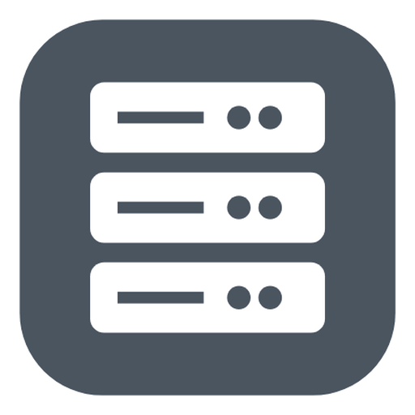

# deploy
Deployment of an AASPIRE line: the server stack (BaSyx, MongoDB, Mosquitto, XMPP, InfluxDB, the DMP, the state store, the web UI, the services, optionally the simulated stations) by Docker Compose, and a Raspberry Pi set up as an IEC 61499 module.

| What | Where |
| --- | --- |
| The lab's AAS stack: BaSyx with MongoDB, Mosquitto, Prosody, InfluxDB, the DMP, the state store (included from `state-store`), the web UI, the skill service, the agents | `aas/compose.yaml`, `aas.py` (`up`, `status`, `rows`, `down`) |
| The simulated PackML stations (included from `station-simulator`) | `aas/stations.yaml`, `aas.py up --stations` |
| The stack as one system: the state store and its vocabulary, every mapping installed, a skill call from BaSyx through the DMP to a station with its state in the store, the web UI | `tests/test_stack.py` (`pytest tests/test_stack.py --stack --stations` on a stack that is up); nightly and on demand in CI (`.github/workflows/stack.yml`) |
| Publish every AAS of the line (aas-model's instances, the example line, the modules on their Pis) | `publish.py` |
| A module's Raspberry Pi: FORTE's container (installed by forte-runtime's `install.sh`), install, run the module, its log | `pi/`, `pi.py` |
| At the bench: status, homing, moves and skills with a watchdog; the stepper's test | `bench.py`, `steptest.py` |
| Docker's own networks out of the lab network (172.20.0.0/15) | `docker_pools.py` (`pi.py pools` on a Pi) |
| The modules run in Python (modpy) on a Pi | `modpy/` |

```powershell
python aas.py up                                                     # the stack on this computer
python aas.py up --stations                                          # ... with the simulated stations
python -m pytest tests/test_stack.py --stack --stations              # the stack as one system
python publish.py                                                    # every AAS, created or replaced
python pi.py install --spec ../aseptic-line/cell/modules/capping.yaml --forte ../forte-runtime/bin/forte-aarch64
python bench.py status --spec ../aseptic-line/cell/modules/capping.yaml
```

The tools find the other repositories beside this one (`AAU-AASPIRE/<repo>`): the line's specs in
`aseptic-line`, FORTE in `forte-runtime`, the DMP (`aas-camel-dmp`) and the web UI
(`basyx-aas-web-ui`) for the stack's images. The services' and modpy's images are built from the
folder that holds the repositories (`aas/services.Dockerfile`, `modpy/Dockerfile`). Part of
[AASPIRE](https://github.com/AAU-AASPIRE/aaspire).
